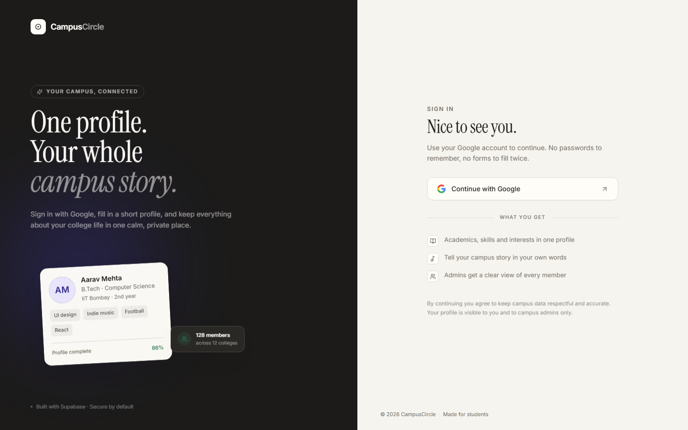
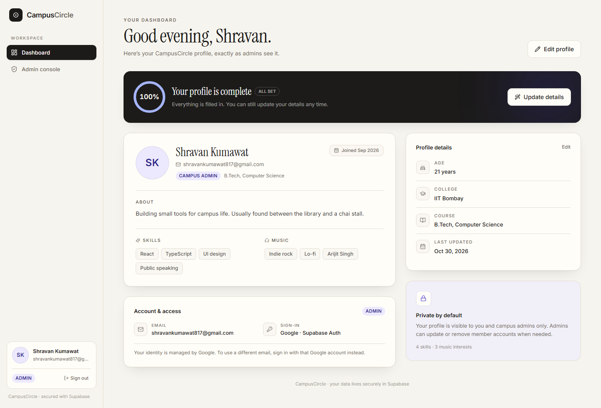
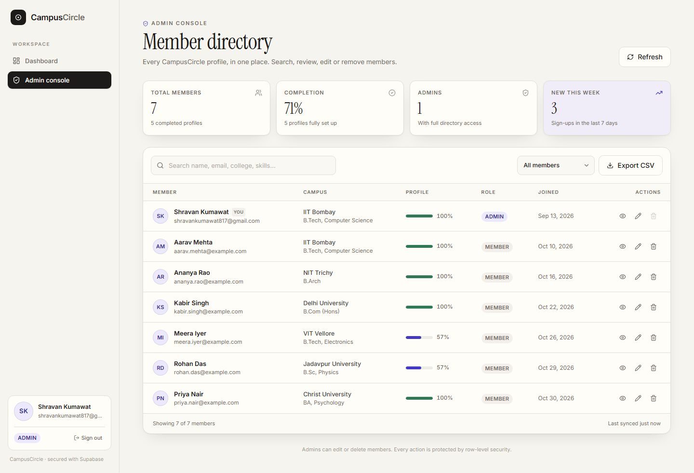

# CampusCircle

A small, focused campus directory built with **React + Vite + TypeScript**, **Tailwind CSS**, and **Supabase**. Students sign in with Google, complete a short profile, and get a private dashboard. Campus admins get a searchable directory where they can view, edit, export, and delete member records.



## Features

- **Google-only sign-in** through Supabase Auth — no passwords.
- **Three-step onboarding**: basics, campus, and interests.
- **User dashboard** with profile completion, skills, music interests, and account details.
- **Admin console** with live stats, search, filters, member detail view, inline editing, and permanent deletion.
- **CSV export** of the current filtered member list.
- **Row-level security** — students can only read and update their own profile; admins can read everything.
- **Responsive UI** with a warm, editorial visual style and no UI component library.

| Dashboard | Admin console |
| --- | --- |
|  |  |

## Tech stack

| Layer | Choice |
| --- | --- |
| Frontend | React 18, TypeScript, Vite |
| Styling | Tailwind CSS v4, Instrument Serif + Inter |
| Routing | React Router |
| Backend / DB | Supabase Postgres, Auth, Row Level Security |
| Icons | lucide-react |

The app talks to Supabase directly from the browser using the public anon/publishable key. It never needs or exposes a service-role key; destructive admin actions go through a `SECURITY DEFINER` database function that checks the caller's role.

## Getting started

### 1. Install dependencies

```bash
npm install
```

### 2. Create the database schema

1. Open your project at [supabase.com](https://supabase.com).
2. Go to **SQL Editor → New query**.
3. Paste the entire contents of [`supabase/migrations/20261031000000_init.sql`](supabase/migrations/20261031000000_init.sql) and click **Run**.

This creates:

- `public.profiles` — one row per auth user.
- A trigger that creates a profile on first Google sign-in.
- `updated_at` handling and protection against role/email self-escalation.
- RLS policies and column-level grants.
- `is_admin()` and `admin_delete_user()` database functions.
- A backfill for accounts that existed before the migration.

> **Admin account:** the migration treats `shravankumawat817@gmail.com` as the initial admin. Change that email in both places in the SQL file before running, or promote someone later (see [Admin access](#admin-access)).

### 3. Enable Google authentication

In **Google Cloud Console**:

1. Create/select a project.
2. Configure the **OAuth consent screen** (External, app name, support email, `email` + `profile` scopes).
3. Go to **APIs & Services → Credentials → Create credentials → OAuth client ID**.
4. Choose **Web application**.
5. Add authorized redirect URI:
   `https://<your-project-ref>.supabase.co/auth/v1/callback`
6. Copy the **Client ID** and **Client secret**.

In **Supabase Dashboard**:

1. **Authentication → Providers → Google** → enable and paste the Client ID/secret.
2. **Authentication → URL Configuration**:
   - **Site URL:** `http://localhost:5173`
   - **Redirect URLs:** add `http://localhost:5173/**`
   - When deployed, add your production URL and `https://your-domain/**` too.

The app redirects back to `window.location.origin` after Google sign-in, so the site URL must be allowlisted.

### 4. Configure environment variables

```bash
cp .env.example .env
```

On Windows PowerShell:

```powershell
Copy-Item .env.example .env
```

Fill in the values from **Project Settings → API**:

```env
VITE_SUPABASE_URL=https://your-project-ref.supabase.co
VITE_SUPABASE_ANON_KEY=your-anon-or-publishable-key
```

Supabase's dashboard shows `NEXT_PUBLIC_*` names in some snippets. This project accepts those too:

```env
NEXT_PUBLIC_SUPABASE_URL=...
NEXT_PUBLIC_SUPABASE_PUBLISHABLE_KEY=...
```

Restart the dev server after changing `.env`.

### 5. Run it

```bash
npm run dev
```

Open <http://localhost:5173>, click **Continue with Google**, and complete onboarding.

## Admin access

Sign in with the admin email configured in the migration. The admin link appears in the sidebar automatically.

To promote another member, run this in the Supabase SQL Editor:

```sql
update public.profiles
set role = 'admin'
where email = 'someone@example.com';
```

To remove admin access:

```sql
update public.profiles
set role = 'user'
where email = 'someone@example.com';
```

Rules enforced by the database:

- Admins cannot delete their own account from the console.
- The last remaining admin cannot be deleted.
- Non-admins cannot change their own `role` or `email`, even with a hand-crafted API request.

## Data model

`public.profiles`

| Column | Type | Notes |
| --- | --- | --- |
| `id` | `uuid` | PK, references `auth.users(id)` with cascade delete |
| `email` | `text` | Synced from the auth provider at signup |
| `full_name` | `text` | From Google, editable by the member |
| `avatar_url` | `text` | Google avatar |
| `age` | `integer` | 13–100 |
| `college` | `text` | |
| `course` | `text` | |
| `skills` | `text[]` | Up to 12 from the UI |
| `music_interests` | `text[]` | Up to 12 from the UI |
| `bio` | `text` | Max 400 characters |
| `role` | `user_role` | `user` or `admin` |
| `onboarding_completed` | `boolean` | Set when the member finishes setup |
| `created_at` / `updated_at` | `timestamptz` | Managed automatically |

## Security model

- RLS is enabled on `profiles`.
- Members can `select` and `update` only their own row.
- Admins can `select` and `update` every row (via `is_admin()`, a `SECURITY DEFINER` helper).
- Column grants prevent browser clients from writing `role`, `email`, `id`, or timestamps.
- A trigger also restores those protected fields for non-admin updates.
- Profile rows are created only by the auth trigger, not inserted from the browser.
- Deleting a user calls `admin_delete_user(uuid)`, which verifies the caller is an admin, refuses self-deletes, refuses deleting the final admin, then deletes the `auth.users` row (profiles cascade).
- The anon/publishable key is public by design. Never add a service-role key to a `VITE_*` variable.

## Project structure

```
.
├─ docs/screenshots/            # README images
├─ src/
│  ├─ components/
│  │  ├─ admin/                 # member detail modal
│  │  ├─ layout/                # sidebar + app shell
│  │  ├─ profile/               # shared onboarding/edit form
│  │  └─ ui/                    # buttons, fields, modal, toast, etc.
│  ├─ context/AuthContext.tsx   # session + profile state
│  ├─ lib/                      # Supabase client, types, formatting
│  ├─ pages/                    # login, onboarding, user, admin
│  ├─ App.tsx                   # routes + auth guards
│  └─ index.css                 # Tailwind theme and design tokens
├─ supabase/migrations/         # run this in the SQL Editor
├─ .env.example
└─ vercel.json                  # SPA fallback for Vercel
```

## Scripts

| Command | Description |
| --- | --- |
| `npm run dev` | Start Vite on port 5173 |
| `npm run build` | Type-check and build to `dist/` |
| `npm run preview` | Preview the production build |
| `npm run typecheck` | Type-check only |

## Deployment

This is a static SPA. Vercel works with the included `vercel.json`; Netlify needs a `_redirects` rule pointing all routes to `/index.html`.

1. Push the repo to GitHub.
2. Import it into Vercel.
3. Add `VITE_SUPABASE_URL` and `VITE_SUPABASE_ANON_KEY` (or the `NEXT_PUBLIC_*` equivalents) as environment variables.
4. In Supabase **URL Configuration**, add your production domain to **Site URL** and **Redirect URLs**.
5. In Google Cloud Console, the redirect URI stays the Supabase callback (`https://<project-ref>.supabase.co/auth/v1/callback`); add the production domain to authorized JavaScript origins if needed.

## Troubleshooting

| Symptom | Fix |
| --- | --- |
| Yellow “Supabase isn't connected yet” banner | `.env` is missing/placeholder, or the dev server wasn't restarted. |
| “We couldn't load your profile” | Run the SQL migration. Confirm `public.profiles` exists and the trigger is installed. |
| `Unsupported provider: provider is not enabled` | Enable Google under Authentication → Providers. |
| `redirect_uri_mismatch` | Add `https://<project-ref>.supabase.co/auth/v1/callback` to the Google OAuth client. |
| Signed in but bounced back to login | Add your app origin to Supabase Redirect URLs. |
| No Admin console in the sidebar | Your profile role is `user`. Promote the email with the SQL above and refresh. |
| 404 / permission denied for `profiles` | The migration hasn't been applied, or grants were changed manually. |
| Delete fails | You're deleting yourself or the last admin — both are intentionally blocked. |

## License

MIT — use it, adapt it, ship it.
